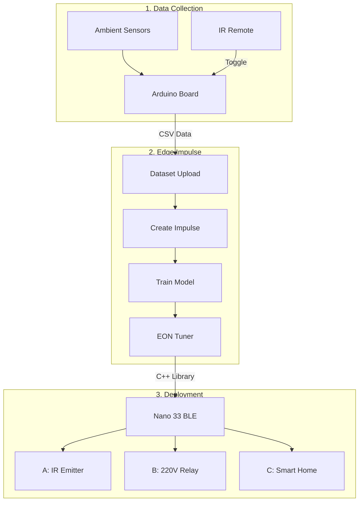

# 🤖 TinyML Data Acquisition & Edge Impulse Tutorial
### *Arduino UNO & Arduino Nano 33 BLE Sense*


> [!IMPORTANT]
> **Project Scope & Engineering Retrospective (Proof of Concept):**  
> This repository was created as an **educational tutorial and technical proof of concept (PoC)** to explore sensor data acquisition, custom interrupt-driven IR triggers, and the end-to-end **Edge Impulse** TinyML workflow.  
> *Note on the HVAC/Temperature ML Model:* Attempting to predict human thermal comfort using solely ambient room sensors (temperature, humidity, light) does not yield an accurate or generalizable model in real-world scenarios, as thermal comfort is highly subjective and requires **personalized/biometric sensors** (e.g., skin temperature, heart rate, wearable data) alongside wider environmental context. Therefore, treat the smart AC scenario purely as a **template pipeline** for deploying AI on microcontrollers.

---

## 📑 Table of Contents
1. [Overview & Custom Universal IR Trigger](#-overview--custom-universal-ir-trigger)
   - [How the Heuristic IR Protocol Works](#how-the-heuristic-ir-protocol-works)
   - [Technical Implementation & IR Limitations](#-technical-implementation--ir-limitations)
2. [Hardware Setup & Schematics](#-hardware-setup--schematics)
   - [Arduino Nano 33 BLE Sense](#1-arduino-nano-33-ble-sense-setup)
   - [Arduino UNO / Mega](#2-arduino-uno--mega-setup)
3. [TinyML Tutorial: Building an AI App with Edge Impulse](#-tinyml-tutorial-building-an-ai-app-with-edge-impulse)
   - [System Architecture & Pipeline](#system-architecture--pipeline)
   - [Step-by-Step Workflow](#step-by-step-workflow)
   - [Real-World Actuation Strategies](#real-world-actuation-strategies)
   - [Hardware Limitations & Comparisons](#hardware-limitations--comparisons)
4. [Conclusion](#-conclusion)

---

## 📡 Overview & Custom Universal IR Trigger

The code in this repository acquires environmental data for Machine Learning applications while allowing the user to manually toggle the **data acquisition mode (ON/OFF)**—or label user comfort states—using **any standard infrared (IR) remote control**.

### How the Heuristic IR Protocol Works
Although the primary goal of this project is TinyML data collection, the **Arduino Nano 33 BLE Sense** sketch includes low-level, interrupt-driven instructions to analyze infrared frames based on the NEC protocol (adapted from [Frank Meyer's IRMP library](https://github.com/ukw100/IRMP/)). 

Instead of decoding full manufacturer-specific frames, this implementation strips away unnecessary parts and reads an **intermediate slice of the 38 kHz PWM frame**. This creates an arbitrary, "universal" protocol capable of reacting to almost any household remote control while actively filtering out false positives (such as accidental triggers when changing TV channels or adjusting the AC).

```mermaid
%%{init: {'flowchart': {'htmlLabels': false, 'padding': 35, 'nodeSpacing': 40, 'rankSpacing': 40}}}%%
flowchart TD
    A["38 kHz IR Remote"] -->|PWM Pulses| B["IR Receiver"]
    B -->|Interrupt| C["measureTimingISR"]
    C -->|Bits > 39| D["Arbitrary Key"]
    D --> E{"translateIR Filter"}
    E -->|TV or AC Key| F["Discard Signal"]
    E -->|Valid Key| G["Toggle Mode"]
```




### 🔍 Technical Implementation & IR Limitations

* **Universal 38 kHz Reception & False-Positive Filtering (`translateIR()`):** Because only an intermediate part of the IR frame is read—chosen via trial and error to maximize compatibility across remotes sending shorter frames or non-NEC protocols—remotes from different brands are recognized as long as they use standard **38 kHz Pulse Width Modulation (PWM)**. However, sampling an arbitrary slice without targeting the most differentiating bits can produce coincidences (false positives) with other household remotes (e.g., TV or AC). Those coincidental key codes are discarded inside the `switch...case` block of the `translateIR()` function so that changing TV channels does not accidentally toggle data collection.
* **Calibrating for Your Own Remotes:** To identify and block false positives from remotes different from mine, simply add `Serial.println(key_s);` at the beginning of the `translateIR()` function to inspect the received codes.
* **Adjusting the Bit Range (`measureTimingISR()`):** If you want to test other parts of the IR frame that might be more differentiable, you can modify the maximum and minimum range values (the two conditional instructions using `>`) on the `ISREdgeCounter` variable inside the `measureTimingISR()` interrupt service routine. If you modify the lower bound (`39` by default), you should also adjust the value `40` in the bit-shifting calculation:
  ```cpp
  key = key + pow(2, (ISREdgeCounter - 40));
  ```
  In short, you can experiment with the three instructions containing `ISREdgeCounter`, which counts the pulses received from the IR sensor on the digital input pin.
* **Why This Code Cannot Be Used for IR Transmission:** These arbitrary IR codes are only valid for **receiving** trigger signals or filtering false positives. They cannot be used to transmit commands to an appliance, because commercial electronics require complete, valid frames of a specific IR protocol with exact manufacturer key codes. Standard microcontroller libraries rely on protocol lookup tables and require physically copying codes from a working remote first (unlike mobile phone IR apps that pull from online databases—likely absent in MCU libraries due to patent or licensing issues). **This code does not solve the problem of emulating broken or missing remotes.**

---

## 🛠️ Hardware Setup & Schematics

### 1. Arduino Nano 33 BLE Sense Setup
Equipped with built-in environmental sensors, the Nano 33 BLE Sense only requires an external IR receiver and a buzzer for audio feedback during data logging.

| Breadboard Schematic | Hardware Prototype |
| :---: | :---: |
|  |  |

**Components List:**
- [x] **1x** Arduino Nano 33 BLE Sense
- [x] **1x** Breadboard & 22 AWG Male-Male / Male-Female jumper wires
- [x] **1x** 38 kHz IR Receiver Module + **1x** Remote Control
- [x] **1x** Passive Buzzer
- [x] **1x** USB-A Male to Micro-USB Male cable

---

### 2. Arduino UNO / Mega Setup
Since the classic Arduino UNO lacks onboard environmental sensors, external modules (DHT11, photoresistor, status LEDs) are wired to collect ambient metrics.

| Breadboard Schematic | Hardware Prototype |
| :---: | :---: |
|  |  |

**Components List:**
- [x] **1x** Arduino UNO or Mega
- [x] **1x** Breadboard (or a shield with mini-breadboard)
- [x] **1x** 38 kHz IR Receiver Module + **1x** Remote Control
- [x] **1x** DHT11 Temperature & Humidity Sensor Module
- [x] **1x** Photoresistor + **1x** 10 kΩ (or 1 kΩ) resistor
- [x] **1x** Active Buzzer
- [x] **1x** Red LED & **1x** Green LED + **2x** 220 Ω resistors
- [x] **1x** USB-A Male to USB-B Male cable & 22 AWG jumper wires

---

## 🧠 TinyML Tutorial: Building an AI App with Edge Impulse


**Edge Impulse** is a powerful online platform for developing and deploying Machine Learning models on edge devices, including microcontrollers like the **Arduino Nano 33 BLE Sense** (note that 8-bit boards like the **Arduino UNO/Mega/Nano** are not officially supported). It simplifies data collection, model training, and deployment for IoT applications without requiring deep ML expertise.

---

### System Architecture & Pipeline

The diagram below illustrates the complete workflow from raw sensor acquisition to real-time inference on the microcontroller:



---

### Step-by-Step Workflow

#### 1️⃣ Hardware & Software Requirements
* **Hardware:** Arduino Nano 33 BLE Sense & USB cable.
* **Software:** [Arduino IDE](https://www.arduino.cc/en/software) & an [Edge Impulse Account](https://edgeimpulse.com/) (Free tier available, with algorithm restrictions noted below).

#### 2️⃣ Data Collection & Preprocessing
1. **Sensor Data Acquisition:** Connect the sensors to your Arduino and use the Arduino IDE to collect environmental readings.
2. **Data Formatting:** Format the acquired telemetry into a structure compatible with Edge Impulse (`.csv` or `.json`).
3. **Dataset Upload:** Create a new project in Edge Impulse and upload your formatted dataset.

#### 3️⃣ Impulse Creation, Algorithm Selection & Training
Inside the **"Create Impulse"** section, you define your AI pipeline by selecting preprocessing blocks and a learning algorithm:
* **Neural Networks (NNs) & Convolutional Neural Networks (CNNs):** These deep learning architectures excel at **modeling complex, non-linear relationships** and automatically extracting high-level features where simple linear functions fall short (making them ideal for complex pattern recognition, audio, or computer vision). However, they also introduce higher structural and computational complexity.
* **Classical Machine Learning & Regression Models:** For simpler numerical or tabular data—such as our temperature control scenario—Regression or Classical Classification algorithms are often the most direct and lightweight choice.
* **Model Training & EON™ Tuner:** Train the selected model by customizing network architecture, epochs, and hyperparameters, or use the **EON Tuner** to automatically search for the optimal model configuration. Finally, evaluate accuracy, precision, and recall in the testing tab.

> [!NOTE]
> **💰 Paywall Notice on Classical ML Algorithms in Edge Impulse:**  
> While Edge Impulse provides Neural Network blocks (Keras-based Classification, Regression, and CNNs) on its free tier, its dedicated **Classical Machine Learning blocks** (scikit-learn based classical regression and classification models) are **restricted to paid Enterprise plans** (limiting free users from deploying them). Ironically, these paid classical algorithms are often the most convenient, interpretable, and resource-efficient models for simple numerical sensor data and constrained microcontrollers.

#### 4️⃣ Model Deployment & Application
Edge Impulse provides several ways to validate and deploy your trained model:
* **Live & Dataset Testing:** Stream real-time sensor data from your connected hardware to the browser for live inference, or run batch evaluations against your dedicated "Test" dataset.
* **Deployment Packages & Code Export:** Generate optimized C++ libraries for Arduino (or Python packages for Raspberry Pi). Using the Arduino IDE, you can upload the exported inference code directly to the **Arduino Nano 33 BLE Sense**—for example, lighting a green/red LED in a Keyword Spotting task, or triggering an appliance based on temperature predictions.

---

### Real-World Actuation Strategies

While the intelligent air conditioner control system is a simplified proof of concept, the data collection hardware can be adapted for physical actuation in three ways:

| Actuation Method | How It Works | Pros ✅ | Cons ❌ |
| :--- | :--- | :--- | :--- |
| **1. Infrared (IR) LED** | Replaces the IR receiver with an IR LED to send ON/OFF commands to the AC or heater. | • Non-invasive<br>• Safe low-voltage circuit | • **No state feedback:** Cannot confirm if the appliance received the command without extra sensors or classic fallback logic (e.g., monitoring temperature trends and retrying). |
| **2. High-Voltage Relay** | Uses a 220V AC relay (compatible with the Nano's 3.3V output) to switch the appliance's main power supply directly. | • Guarantees power control<br>• Bypasses IR protocol issues | • **Risk of Appliance Damage:** Cutting main power is a "forceful" approach. Even if nothing happens immediately, repeated hard power cuts can **cause long-term wear and damage** to the appliance or trigger a **severe sudden failure**. |
| **3. Smart Home / IoT Bots** | Uses smart mechanical actuators (e.g., *Xiaomi Fingerbot*) or integrates with platforms like **Home Assistant**. | • Non-destructive & safe<br>• Wide ecosystem support | • Higher cost & setup complexity<br>• Requires compatible wireless protocols or hubs. |

---

### Hardware Limitations & Comparisons

> [!WARNING]
> **Theoretical Metrics vs. Real-World Deployment:**  
> Promising training metrics do not always translate directly to real-world performance due to sensor noise, environmental variations, and uncaptured variables (such as personalized biometric data in human thermal comfort).

When targeting microcontrollers, you must carefully weigh model complexity against hardware memory boundaries:

* **Classical ML Algorithms (Compact & Ideal for 8-bit MCUs):** Classical Machine Learning algorithms, such as **regression models**, require significantly less processing power and memory than neural networks. Because these models are naturally compact, they are much better suited for resource-constrained boards like the **Arduino UNO** without needing external storage—even though Edge Impulse charges to deploy its Classical ML blocks.
* **Neural Networks (NNs / CNNs) on Constrained Devices:** While Edge Impulse demonstrates efficient resource utilization on the **Arduino Nano 33 BLE Sense** (even with complex neural networks and CNNs), deploying neural networks on an **Arduino UNO** is severely limited by its **2 KB RAM** and **1 KB ROM (EEPROM)**. While examples of running Neural Networks on an Arduino UNO exist, the networks that developers have managed to fit natively are **extremely simplistic and rudimentary**; any larger neural network architecture requires careful design and external memory solutions such as **microSD cards**.

| Feature / Specification | 🚀 Arduino Nano 33 BLE Sense | 🐢 Arduino UNO (ATmega328P) |
| :--- | :--- | :--- |
| **Microcontroller** | nRF52840 (32-bit ARM Cortex-M4 @ 64 MHz) | ATmega328P (8-bit AVR @ 16 MHz) |
| **Memory Limits** | **256 KB RAM** / **1 MB Flash** | **2 KB RAM** / **32 KB Flash** / **1 KB ROM (EEPROM)** |
| **Edge Impulse Support** | ✅ Full Official Support | ❌ Not Supported Natively |
| **Classical ML (e.g., Regression)** | ✅ Effortless *(Paid Enterprise feature in Edge Impulse)* | ✅ **Most suitable approach** — lightweight models fit without external memory |
| **Neural Networks (NNs / CNNs)** | ✅ Handles complex non-linear NNs & CNNs easily | ⚠️ Only **very rudimentary/simplistic NNs** fit natively; larger models require external **microSD cards** |

---

## 🎯 Conclusion

Developing AI applications for microcontrollers like Arduino is becoming increasingly accessible with platforms like **Edge Impulse**. By following the steps outlined in this guide, you can experiment with different algorithms, sensor configurations, and deployment strategies to build responsive IoT prototypes. 

When working with resource-constrained devices, always consider the trade-offs between **non-linear model complexity (NNs/CNNs) vs. lightweight classical algorithms (Regression), platform licensing costs, real-world sensor limitations, and hardware memory constraints** to select the most effective approach for your application.

---
*Created by [@antor44](https://github.com/antor44) — Feel free to fork, experiment, and adapt this pipeline for your own TinyML projects!*

